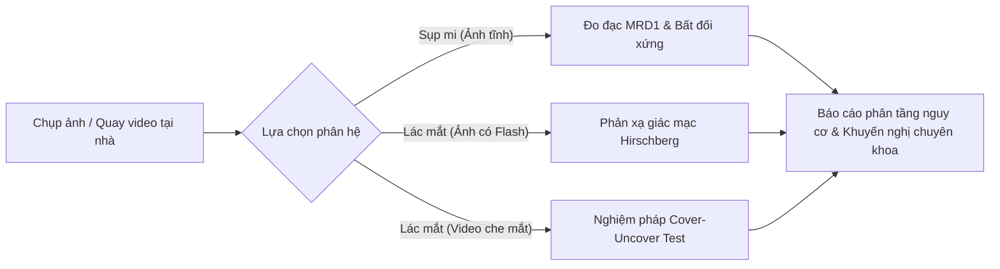
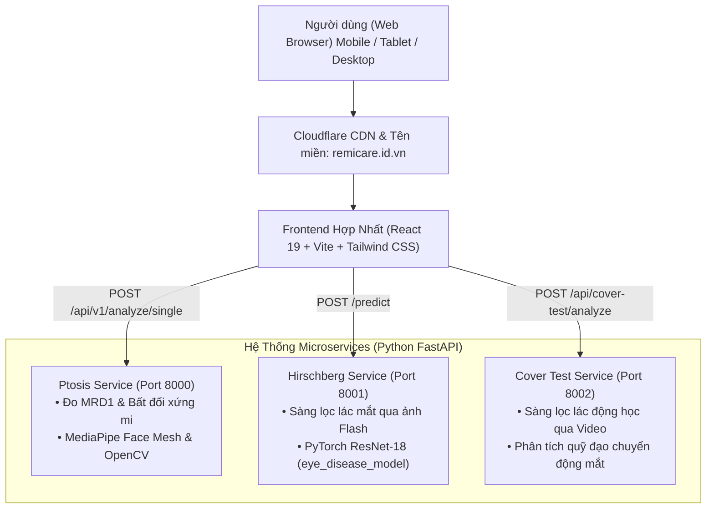
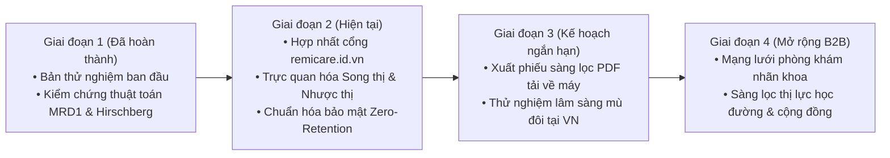

# TÀI LIỆU KỸ THUẬT VÀ TỔNG QUAN GIẢI PHÁP - REMICARE
**Hệ Thống Trợ Lý AI Sàng Lọc Thị Lực Sớm (Sụp Mi & Lác Mắt)**  
*Phiên bản:* **1.3 (Condensed Executive & Technical Brief)**  
*Ngày cập nhật:* **24/10/2026**  
*Cổng thông tin chính thức:* [https://remicare.id.vn](https://remicare.id.vn)

---

## 1. TỔNG QUAN GIẢI PHÁP (EXECUTIVE SUMMARY)

### 1.1 Bài toán thực tế
- **Phát hiện muộn ở trẻ nhỏ:** Các tật lác ẩn (*phoria*) và sụp mi nhẹ (*mild ptosis*) rất khó phát hiện bằng mắt thường tại nhà. Trẻ không được can thiệp trước 7 tuổi (*độ tuổi vàng*) có nguy cơ cao biến chứng thành **nhược thị** (*amblyopia* - suy giảm thị lực vĩnh viễn không thể phục hồi bằng kính).
- **Rào cản tiếp cận:** Khám chuyên khoa mắt đòi hỏi trang thiết bị phức tạp (thước đo Putterman, lăng kính đo góc lác Prism, đèn khe Slit Lamp), vốn chỉ tập trung ở bệnh viện tuyến trung ương.
- **Bất tiện của các giải pháp cũ:** Đa số phần mềm đo lường trước đây bắt buộc người dùng dán thẻ ATM, đồng xu hay sticker lên trán để làm vật chuẩn kích thước, gây phiền toái, mất vệ sinh và khiến hơn 60% người dùng bỏ dở giữa chừng.

### 1.2 Giải pháp RemiCare
**RemiCare** là nền tảng y tế số ứng dụng Trí tuệ Nhân tạo (AI) và Thị giác Máy tính (Computer Vision), cho phép người dùng tự sàng lọc hình thái mi mắt và trục thị giác ngay tại nhà thông qua trình duyệt web:
- **Không cần vật chuẩn (Markerless):** Tự động đo đạc kích thước milimet dựa trên kích thước sinh học của mống mắt người Đông Á.
- **Tiếp cận tức thì (Instant Web Access):** Chạy trực tiếp trên trình duyệt điện thoại và máy tính tại [remicare.id.vn](https://remicare.id.vn), không cần cài đặt ứng dụng.
- **Bảo mật tuyệt đối (Zero-Retention):** Ảnh được giải mã và phân tích trực tiếp trên bộ nhớ RAM, xóa sạch ngay lập tức sau khi xử lý; không lưu trữ bất kỳ hình ảnh khuôn mặt nào trên máy chủ.

---

## 2. PHƯƠNG PHÁP & CƠ SỞ KHOA HỌC (METHODOLOGY & CLINICAL FOUNDATIONS)

RemiCare số hóa 3 quy trình khám nhãn khoa kinh điển thành các thuật toán tự động:

### 2.1 Bảng so sánh 3 phương pháp sàng lọc cốt lõi

| Tiêu chí | 1. Sàng lọc Sụp mi (Ptosis) | 2. Sàng lọc Lác qua ảnh (Hirschberg) | 3. Sàng lọc Lác động học (Cover Test) |
| :--- | :--- | :--- | :--- |
| **Bản chất y khoa** | Đo khoảng cách bờ mi trên - phản xạ đồng tử (**MRD1**) | Xác định vị trí ánh phản xạ giác mạc (**Purkinje Image I**) | Đánh giá chuyển động bù trừ định vị (**Refixation Movement**) |
| **Định dạng đầu vào** | 1 ảnh chân dung nhìn thẳng, mắt mở tự nhiên | 1 ảnh chân dung nhìn thẳng có bật **đèn flash** | 1 đoạn video ngắn 3 - 5 giây che lần lượt từng mắt |
| **Cơ sở y văn** | Putterman (2012), Small & Finsterer (2003) | Hirschberg (1886), von Noorden (2002) | American Academy of Ophthalmology (AAO) |
| **Thời gian xử lý** | **~ 1.0 giây** (rất nhanh) | **~ 9.1 giây** (mô hình học sâu ResNet-18) | **10 - 20 giây** (phân tích chuỗi 10 - 15 FPS) |
| **Kết quả trả về** | - Chỉ số MRD1 từng mắt (mm) - Độ bất đối xứng mí mắt (mm) - Độ rướn cơ trán (pixel) - Phân tầng TIER_A/B/C | - Phân loại: Bình thường / Nghi ngờ lác - Độ tin cậy thuật toán (%) - Vùng mắt phóng to kèm tiêu điểm Purkinje | - Đánh giá lác hiện (*Tropia*) / lác ẩn (*Phoria*) - Đồ thị quỹ đạo nhãn cầu theo thời gian |

---

### 2.2 Đột phá: Cơ chế hiệu chuẩn kích thước không vật chuẩn (Markerless Calibration)
- **Cơ sở sinh học:** Đường kính giác mạc vùng trắng sang trắng (*White-to-White - WTW*) là một hằng số sinh học cực kỳ ổn định ở người trên 2 tuổi. Theo nghiên cứu nhãn khoa trên quần thể người Đông Á (*Chen et al., 2011*), đường kính ngang giác mạc trung bình đạt **$11.71 \pm 0.42\text{ mm}$**.
- **Cách thức thực hiện:**
  $$\text{Tỷ lệ quy đổi (mm/pixel)} = \frac{11.71\text{ mm}}{\text{Đường kính ngang mống mắt (pixels)}}$$
- Nhờ công thức này, hệ thống quy đổi chính xác các khoảng cách pixel trên ảnh thành số đo milimet thực tế mà người dùng không cần cầm theo bất kỳ thẻ đo hay vật đối chứng nào.

---

### 2.3 Tiêu chuẩn phân tầng nguy cơ Sụp mi (Tiers)

- **TIER_A (Bình thường - Xanh lục):** $\text{MRD1} \ge 2.5\text{ mm}$, chênh lệch 2 mắt $\le 1.0\text{ mm}$, chân mày cân đối. Mi mắt không che khuất đồng tử.
- **TIER_B (Nghi ngờ sụp mi nhẹ / Bất đối xứng - Vàng cam):** $\text{MRD1}$ trong khoảng $2.0 - 2.5\text{ mm}$, hoặc chân mày một bên rướn cao $> 8\text{ px}$ (phản xạ bù trừ của cơ trán). Khuyến nghị theo dõi thêm.
- **TIER_C (Nguy cơ cao - Đỏ san hô):** $\text{MRD1} < 2.0\text{ mm}$ (dưới $1.0\text{ mm}$ là sụp mi nặng che lấp trục thị giác), hoặc độ chênh lệch giữa hai mắt $> 2.0\text{ mm}$. Cần đến bệnh viện mắt để kiểm tra cơ nâng mi.

---

## 3. DANH MỤC MÔ HÌNH AI & THUẬT TOÁN (AI MODELS & PROCESSING)

| Tên mô hình / Thuật toán | Loại công nghệ | Vai trò trong hệ thống | Đầu vào $\rightarrow$ Đầu ra |
| :--- | :--- | :--- | :--- |
| **MediaPipe Face Mesh** | Deep Learning (Google) | Trích xuất 468 mốc khuôn mặt và **71 mốc chuyên dụng vùng mắt** | Ảnh khuôn mặt $\rightarrow$ Tọa độ 3D mi mắt, mống mắt, chân mày |
| **ResNet-18 Deep CNN** | Convolutional Neural Network (PyTorch) | Phân loại lác mắt dựa trên ảnh cắt vùng mắt có ánh phản xạ | Ảnh mắt có đèn Flash $\rightarrow$ Nhãn: Bình thường / Nghi ngờ lác |
| **Ellipse Fitting Algorithm** | Computer Vision (OpenCV) | Khớp đường bao elip mống mắt chính xác đến cấp độ sub-pixel | Các điểm mốc mống mắt $\rightarrow$ Tâm đồng tử & Đường kính mống mắt (pixel) |
| **Trajectory Consensus Model** | Computer Vision & Signal Processing | Theo dõi vector chuyển động của nhãn cầu qua từng khung hình video | Video 10-15 FPS $\rightarrow$ Tốc độ & Biên độ chuyển động định vị mắt |
| **Head Pose & EAR Calculator** | Phép chiếu phối cảnh PnP & Hình học | Bộ lọc chất lượng ảnh (Quality Gate) | Điểm mốc khuôn mặt $\rightarrow$ Góc nghiêng đầu ($^\circ$) & Độ mở mắt (EAR) |

---

### Bộ lọc chất lượng ảnh (Quality Gate - Bảo vệ độ chính xác)
Trước khi đưa ảnh vào phân tích sâu, thuật toán tự động kiểm tra nghiêm ngặt:
1. **Góc nghiêng đầu (Head Pose):** Góc quay trái/phải (*Yaw*) $\le 12^\circ$, ngửa/cúi (*Pitch*) $\le 12^\circ$, nghiêng (*Roll*) $\le 8^\circ$.
2. **Độ mở mắt (Eye Aspect Ratio - EAR):** Yêu cầu $\text{EAR} > 0.15$ (đảm bảo mắt mở tự nhiên, không nhắm mắt hoặc chớp mắt dở dang).
3. **Độ phân giải:** Vùng khuôn mặt đạt tối thiểu $100 \times 100\text{ pixels}$.
4. **Độ sáng:** Cân bằng ánh sáng hai bên mặt, không bị lóa hoặc quá tối.

---

## 4. KIẾN TRÚC HỆ THỐNG & TECH STACK (ARCHITECTURE & TECHNOLOGIES)

### 4.1 Sơ đồ kiến trúc phân tán

---

### 4.2 Chi tiết Tech Stack

| Tầng thành phần | Công nghệ / Thư viện chính | Phiên bản | Mục đích sử dụng |
| :--- | :--- | :--- | :--- |
| **Frontend UI/UX** | **React** + **Vite** | React 19.x | Ứng dụng Single Page Application (SPA), giao diện mượt mà |
| | **Tailwind CSS** | 3.4.x / 4.x | Thiết kế giao diện responsive (chuẩn cho cả mobile và desktop) |
| | **MediaPipe Tasks Vision** | 0.10.x | Tiền xử lý khung hình camera trực tiếp trên trình duyệt |
| | **Lucide React** | 1.16.x | Bộ icon giao diện y tế hiện đại, trực quan |
| **Backend Ptosis** | **FastAPI** + **Uvicorn** | Python 3.10+ | REST API hiệu năng cao đo đạc hình thái mí mắt (Port 8000) |
| | **MediaPipe** + **OpenCV** | 0.10.x / 4.8+ | Trích xuất 478 mốc khuôn mặt, khớp elip mống mắt |
| **Backend Hirschberg** | **PyTorch** | 2.0+ (CPU) | Chạy mạng nơ-ron ResNet-18 phát hiện lác mắt qua ảnh (Port 8001) |
| | **Asyncio Single-Lock** | Built-in | Khóa an toàn ngăn máy chủ CPU bị quá tải khi xử lý |
| **Backend Cover Test** | **FastAPI** + **OpenCV Video**| Python 3.10+ | Xử lý chuỗi khung hình video bóc tách chuyển động mắt (Port 8002) |
| **Hạ tầng mạng & Tên miền** | **Domain chính thức** | DNS Host | `https://remicare.id.vn` (SSL Let's Encrypt) |
| | **Chuyển hướng vĩnh viễn**| Nginx 301 | Đưa domain cũ `ptosis-check.remicare.id.vn` về trang chủ mới |

---

## 5. AN TOÀN DỮ LIỆU & BẢO VỆ QUYỀN RIÊNG TƯ (SECURITY & COMPLIANCE)

> [!IMPORTANT]
> **Cam kết Zero-Retention (Không lưu trữ dữ liệu khuôn mặt):**
> Hình ảnh khuôn mặt của người dùng **CHỈ** được giải mã tạm thời trong bộ nhớ RAM của máy chủ để trích xuất các mảng số tọa độ hình học (landmarks). Ngay sau khi có kết quả, dữ liệu pixel gốc bị hàm `purge_image_data()` **xóa sạch hoàn toàn** khỏi bộ nhớ. Máy chủ **tuyệt đối không lưu file ảnh xuống đĩa cứng, cơ sở dữ liệu hay bất kỳ dịch vụ đám mây bên ngoài nào**.

### Nguyên tắc truyền thông y tế an toàn (Non-Diagnostic)
- **Định vị pháp lý:** RemiCare là **công cụ sàng lọc hỗ trợ cộng đồng**, không phải là thiết bị chẩn đoán y tế và không thay thế bác sĩ chuyên khoa mắt.
- **Quy tắc ngôn từ:**
  - ✅ **Được dùng:** *Sàng lọc, nhận diện dấu hiệu nghi ngờ, bất đối xứng hình thái, khuyến nghị thăm khám chuyên khoa, người dùng*.
  - ❌ **Cấm dùng:** *Chẩn đoán, điều trị, chữa khỏi, bệnh nhân, đơn thuốc, thay thế bác sĩ nhãn khoa*.

---

## 6. LƯU Ý VẬN HÀNH & NĂNG LỰC HỆ THỐNG CHO CHIẾN DỊCH (OPERATIONAL CAPACITY)

- **Hiệu năng xử lý:**
  - Sàng lọc sụp mi: **~ 1.0 giây** $\rightarrow$ Đáp ứng lưu lượng lớn, phù hợp làm nội dung phễu tiếp cận ban đầu.
  - Sàng lọc lác mắt (Hirschberg): **~ 9.1 giây** trên CPU máy chủ.
- **Cơ chế khóa đơn luồng (`_prediction_lock`):**
  - Nhằm bảo vệ máy chủ không bị treo khi chạy mô hình học sâu ResNet-18 trên CPU, backend Hirschberg chỉ xử lý **1 yêu cầu tại một thời điểm**.
  - Nếu có yêu cầu thứ hai gửi đến đồng thời, hệ thống sẽ trả về mã `HTTP 503 (Retry-After: 2)`.
  - **Khuyến nghị cho Marketing:** Không chạy quảng cáo dồn lượng truy cập lớn trong vài phút (tránh flash mob traffic); phân bổ ngân sách đều trong ngày hoặc triển khai thêm hàng đợi (Queue) khi nâng cấp hạ tầng GPU.

---

## 7. ĐỊNH HƯỚNG MỞ RỘNG & HỢP TÁC B2B (ROADMAP & COLLABORATION)

1. **Phiếu kết quả PDF tổng hợp (Downloadable PDF Report):**
   Người dùng có thể xuất file PDF lưu lại kết quả sàng lọc chuẩn y văn (đường vẽ mi mắt, chỉ số MRD1, ảnh phản xạ Purkinje) để mang trực tiếp đến gặp bác sĩ mắt mà hệ thống vẫn không cần lưu dữ liệu cá nhân.
2. **Mô phỏng thị giác cảm xúc (Vision Simulator):**
   Module trực quan hóa tầm nhìn **Song thị** (*Diplopia*) và **Nhược thị** (*Amblyopia*), giúp người nhà thấu hiểu cảm giác của người mắc tật về mắt, từ đó kích hoạt hành vi đưa trẻ đi khám sớm.
3. **Mô hình hợp tác Phòng khám / Bệnh viện Mắt (B2B Referral):**
   Tại trang kết quả nghi ngờ bất thường (Tier B, Tier C), hệ thống cung cấp danh mục các phòng khám nhãn khoa uy tín gần nhất để người dùng chủ động liên hệ đặt lịch khám chuyên sâu.

---
*Tài liệu được tổng hợp và chuẩn hóa dựa trên toàn bộ mã nguồn thực tế của hệ thống RemiCare.*  
*Liên hệ hỗ trợ kỹ thuật và hợp tác: `contact@remicare.id.vn` | Website: `https://remicare.id.vn`*
